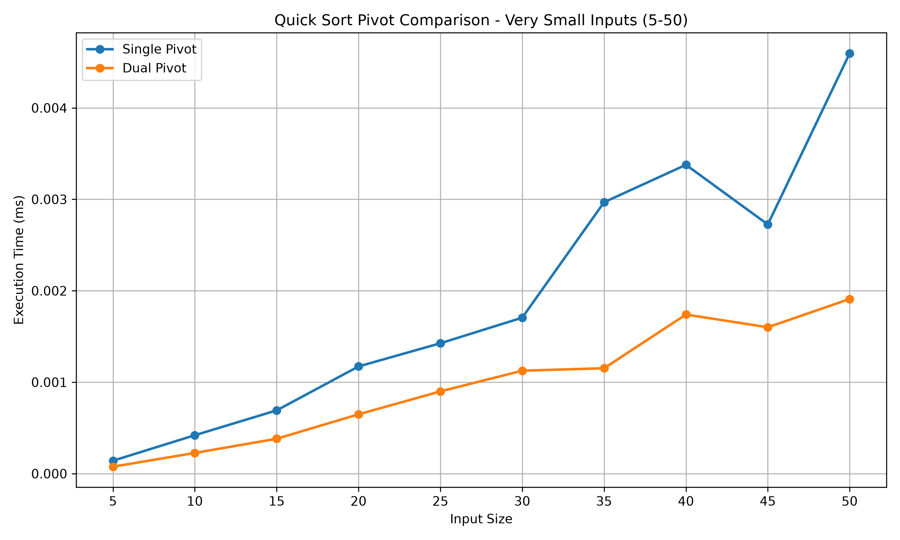
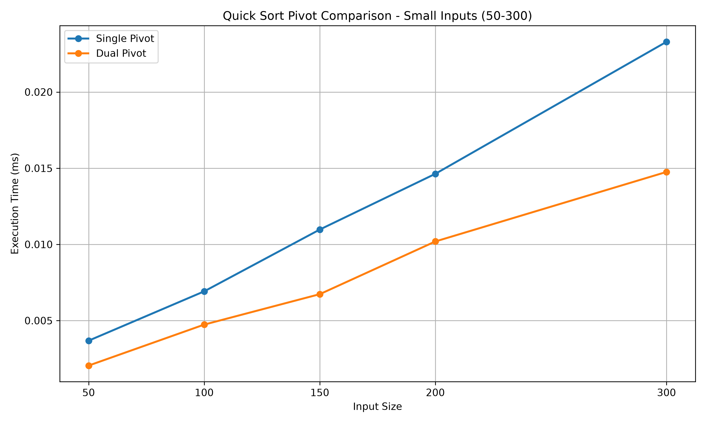
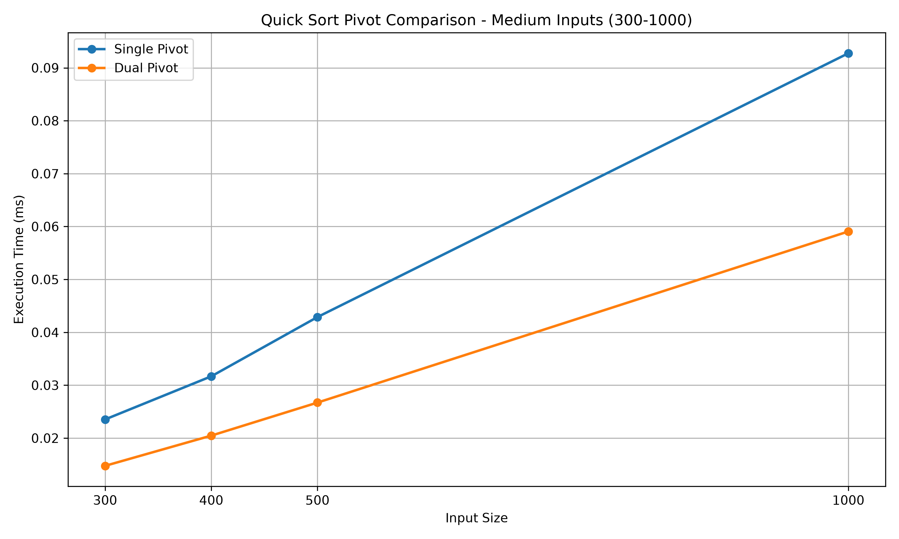
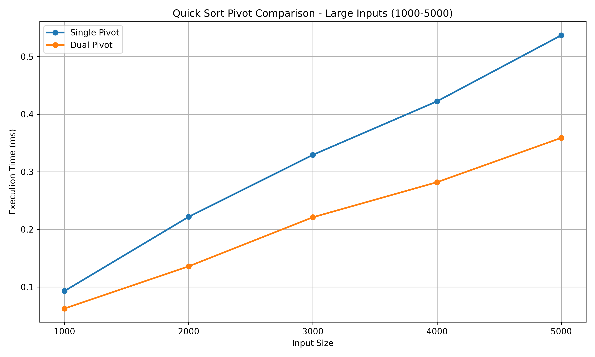
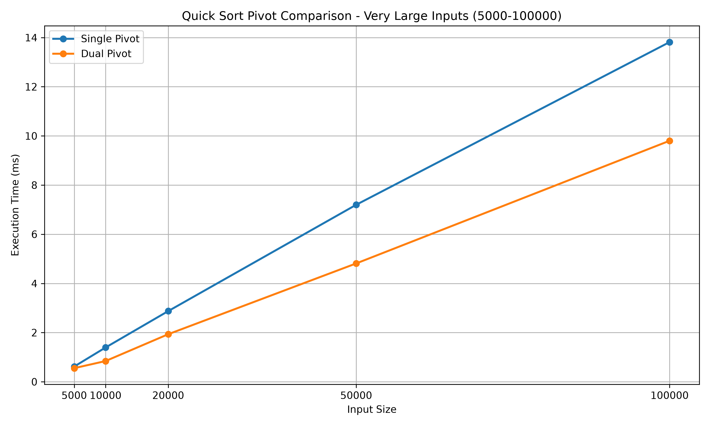
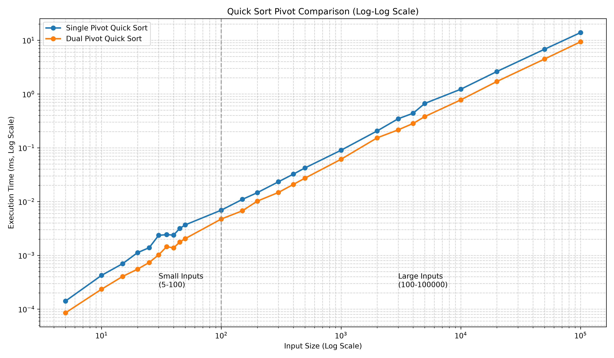

# QuickSort Pivot Analysis

A C++ benchmarking project that compares Single-Pivot and Dual-Pivot Quick Sort implementations to investigate how increasing the number of pivots affects sorting performance.

## Overview

Quick Sort is one of the most widely used comparison-based sorting algorithms due to its simplicity and excellent average-case performance.

This project benchmarks two variants:

- Single-Pivot Quick Sort
- Dual-Pivot Quick Sort

The goal is to determine whether increasing the number of pivots improves practical runtime while preserving the same theoretical complexity.

---

## Algorithms

### Single-Pivot Quick Sort

The Single-Pivot implementation selects a random pivot and partitions the array into two regions:

```text
<= Pivot
> Pivot
```

The resulting subarrays are sorted recursively.

### Dual-Pivot Quick Sort

The Dual-Pivot implementation partitions the array using two pivot elements:

```text
< Pivot1

Pivot1 <= x <= Pivot2

> Pivot2
```

This creates three regions instead of two and often produces more balanced recursive partitions.

---

## Complexity Analysis

Let:

```text
n
```

be the number of elements.

| Algorithm | Average Case | Worst Case | Space |
|------------|-------------|------------|--------|
| Single-Pivot Quick Sort | O(n log n) | O(n²) | O(log n) |
| Dual-Pivot Quick Sort | O(n log n) | O(n²) | O(log n) |

Both algorithms have identical asymptotic complexity. Any performance difference therefore comes from implementation efficiency, partition quality, and constant factors rather than improved Big-O complexity.

---

## Benchmark Setup

Execution time was measured using:

```cpp
QueryPerformanceCounter()
```

Input sizes:

```text
5
10
15
20
25
30
35
40
45
50
100
150
200
300
400
500
1000
2000
3000
4000
5000
10000
20000
50000
100000
```

To ensure a fair comparison:

1. A random dataset was generated.
2. Two identical copies were created.
3. Single-Pivot Quick Sort processed one copy.
4. Dual-Pivot Quick Sort processed the other copy.

This ensured that both algorithms always sorted exactly the same data.

---

## Performance Comparison

| Size | Single Pivot (ms) | Dual Pivot (ms) | Improvement |
|------:|------:|------:|------:|
| 100 | 0.00772 | 0.00451 | 41.6% |
| 1,000 | 0.09128 | 0.06416 | 29.7% |
| 10,000 | 1.11442 | 0.79344 | 28.8% |
| 100,000 | 13.80490 | 9.59887 | 30.5% |

### Key Finding

Dual-Pivot Quick Sort outperformed Single-Pivot Quick Sort for every tested input size.

For arrays containing:

```text
100,000 elements
```

Single-Pivot Quick Sort required:

```text
13.80 ms
```

whereas Dual-Pivot Quick Sort completed in:

```text
9.60 ms
```

representing an improvement of approximately:

```text
30%
```

---

## Results and Analysis

### Very Small Inputs (5–50)



Even for extremely small arrays, Dual-Pivot Quick Sort consistently achieved lower execution times.

Examples:

| Size | Single Pivot (ms) | Dual Pivot (ms) |
|------:|------:|------:|
| 5 | 0.000154 | 0.000127 |
| 25 | 0.001421 | 0.000806 |
| 50 | 0.003222 | 0.001960 |

The difference is small in absolute terms but remains consistent across the entire range.

---

### Small Inputs (50–300)



The performance advantage becomes more visible.

| Size | Single Pivot (ms) | Dual Pivot (ms) |
|------:|------:|------:|
| 100 | 0.007720 | 0.004510 |
| 200 | 0.014882 | 0.009487 |
| 300 | 0.023143 | 0.015217 |

Dual-Pivot Quick Sort required approximately 35–40% less execution time throughout this range.

---

### Medium Inputs (300–1000)



Both algorithms continue following the same growth trend, but the gap between them remains clearly visible.

| Size | Single Pivot (ms) | Dual Pivot (ms) |
|------:|------:|------:|
| 500 | 0.040579 | 0.027025 |
| 1000 | 0.091283 | 0.064156 |

The data indicates that the benefit of using two pivots is sustained as the input size increases.

---

### Large Inputs (1000–5000)



The runtime difference becomes significant.

| Size | Single Pivot (ms) | Dual Pivot (ms) |
|------:|------:|------:|
| 2000 | 0.195024 | 0.132327 |
| 3000 | 0.299478 | 0.206912 |
| 5000 | 0.525814 | 0.368812 |

Dual-Pivot Quick Sort consistently performs the same sorting task in noticeably less time.

---

### Very Large Inputs (5000–100000)



This range provides the clearest picture of practical performance.

| Size | Single Pivot (ms) | Dual Pivot (ms) |
|------:|------:|------:|
| 10000 | 1.11442 | 0.79344 |
| 50000 | 6.87260 | 4.82085 |
| 100000 | 13.80490 | 9.59887 |

As the input size grows, the performance advantage remains stable rather than disappearing.

This indicates that the improvement is not caused by measurement noise or startup overhead.

---

### Logarithmic Runtime Comparison



This is the most important graph in the project.

The two curves remain nearly parallel throughout the entire benchmark range.

This indicates that both implementations exhibit:

```text
O(n log n)
```

average-case complexity.

The Dual-Pivot curve remains consistently below the Single-Pivot curve, demonstrating that the runtime improvement comes from better partitioning and reduced constant factors rather than a change in asymptotic complexity.

---

## Build

Compile:

```bash
g++ src/main.cpp src/QuickSorts.cpp -o benchmark
```

---

## Run Benchmark

Execute:

```bash
./benchmark.exe
```

The program will:

1. Generate random datasets
2. Benchmark both Quick Sort variants
3. Export results to:

```text
data/data.csv
```

---

## Generate Graphs

Install dependencies:

```bash
py -3.13 -m pip install pandas matplotlib
```

Generate all figures:

```bash
py -3.13 report/graph.py
```

Generated files:

```text
report/
├── very_small_inputs.png
├── small_inputs.png
├── medium_inputs.png
├── large_inputs.png
├── very_large_inputs.png
└── runtime_logarithmic.png
```

---

## Project Structure

```text
quicksort-pivot-analysis
│
├── data/
│   └── data.csv
│
├── report/
│   ├── graph.py
│   ├── very_small_inputs.png
│   ├── small_inputs.png
│   ├── medium_inputs.png
│   ├── large_inputs.png
│   ├── very_large_inputs.png
│   └── runtime_logarithmic.png
│
├── src/
│   ├── QuickSorts.h
│   ├── QuickSorts.cpp
│   └── main.cpp
│
├── README.md
└── benchmark.exe
```

---

## Conclusion

Both Single-Pivot and Dual-Pivot Quick Sort exhibited the expected:

```text
O(n log n)
```

average-case complexity.

However, the benchmarks showed that Dual-Pivot Quick Sort consistentlywth, while the runtime measurements demonstrated that using two pivots improved practical performance by approximately 30–40%.

These results show that algorithmic design decisions affecting partition quality can have a substantial impact on real-world performance even when the theoretical complexity remains unchanged.

---

## Author

**Desire Roslin Dziele**  
Computer Science Student  
University of Łódź